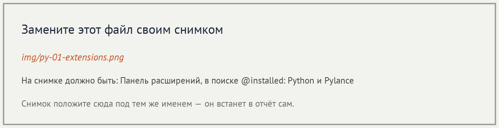
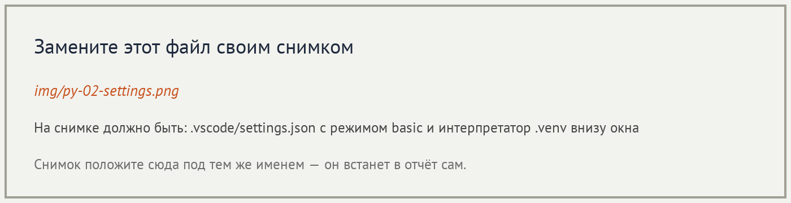
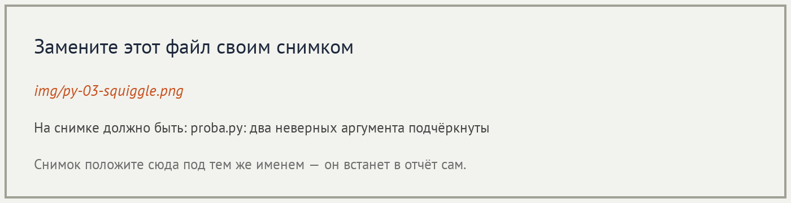
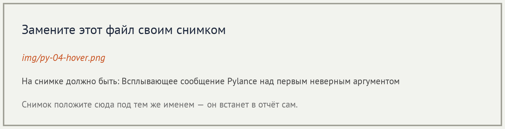
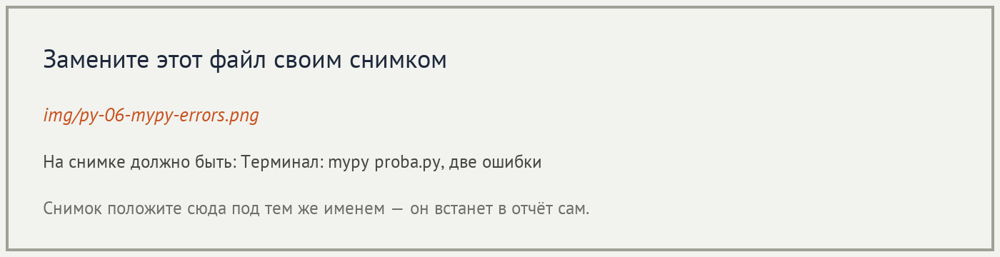
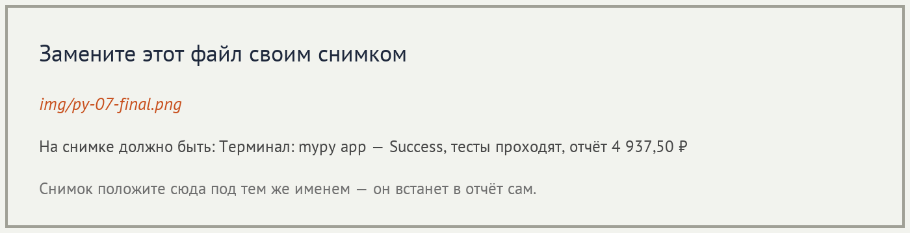

# Отчёт · Проверка типов: Pylance и mypy

**Студент:** Абдуллаев Билол, группа ✏️

## 1. Подготовка

В VS Code стоят расширения Python и Pylance. Для проекта создано окружение
`.venv` (`py -m venv .venv`, `pip install -r requirements.txt`: pytest, ruff,
mypy 1.15.0). В `.vscode/settings.json` включён режим проверки `basic`
и указан интерпретатор из `.venv`:

```json
{
  "python.analysis.typeCheckingMode": "basic",
  "python.defaultInterpreterPath": "${workspaceFolder}/.venv/Scripts/python.exe",
  ...
}
```





## 2. Проверка в редакторе

```python
from app.utils.formatter import format_kopeks, format_title

print(format_kopeks("150000"))
print(format_title("Итого", width="40"))
```





Сообщение над первым аргументом: `Argument of type "Literal['150000']" cannot be
assigned to parameter "kopeks" of type "int" in function "format_kopeks"`.

Разбор сообщения:

| Часть сообщения | Что означает |
|---|---|
| `Argument of type "Literal['150000']"` | что передали: строку `"150000"`; Pylance знает даже точное значение литерала |
| `parameter "kopeks" of type "int"` | куда передали: параметр `kopeks`, который по подписи ждёт целое число копеек |
| `in function "format_kopeks"` | в какой функции подпись не совпала с вызовом; `cannot be assigned` — строку нельзя положить туда, где ждут `int` |


## 3. Проверка в терминале

```text
> mypy proba.py
proba.py:3: error: Argument 1 to "format_kopeks" has incompatible type "str"; expected "int"  [arg-type]
proba.py:4: error: Argument "width" to "format_title" has incompatible type "str"; expected "int"  [arg-type]
Found 2 errors in 1 file (checked 1 source file)
```



После исправления вызовов на `format_kopeks(150000)` и `format_title("Итого", width=40)`:

```text
> mypy proba.py
Success: no issues found in 1 source file
```

## 4. Проект без аннотаций

В `pyproject.toml` включено `disallow_untyped_defs = true`, поэтому каждая
функция без аннотаций — ошибка. Аннотации расставлены снизу вверх по слоям:
сначала то, от чего зависят остальные.

| Этап | Итог `mypy app` |
|---|---|
| исходно | Found 17 errors in 10 files (checked 15 source files) |
| после `utils` | Found 12 errors in 7 files (checked 15 source files) |
| после `domain` | Found 8 errors in 5 files (checked 15 source files) |
| после `services` | Found 1 error in 1 file (checked 15 source files) |
| после `ui` | Success: no issues found in 15 source files |

Модуль до и после — `app/services/orders.py`:

```python
def load_orders(path):
def revenue_by_waiter(orders, top=0):
    totals = {}
def sort_orders_in_place(orders):
```

```python
def load_orders(path: Path) -> list[Order]:
def revenue_by_waiter(orders: list[Order], top: int = 0) -> dict[str, int]:
    totals: dict[str, int] = {}
def sort_orders_in_place(orders: list[Order]) -> None:
```

```text
> mypy app
Success: no issues found in 15 source files

> python -m pytest -q
............                                                             [100%]
12 passed in 0.04s

> python main.py
=========== Смена 16.11.2026 ===========
Петрова Анна                  2 480,50 ₽
Иванов Пётр                   1 685,00 ₽
Сидоров Илья                    772,00 ₽
=========== Итого 4 937,50 ₽ ===========
```



## 5. Выводы

Pylance и mypy находят несовпадение типов ещё до запуска: строку вместо числа,
забытый `None`, функцию без аннотаций. Pylance показывает это сразу при наборе,
а mypy проверяет весь проект одной командой, и её можно поставить в CI.
Неожиданно было, что mypy в первом прогоне не говорит, *какие* типы нужны, —
только «нет аннотации»; тип приходится выводить из того, как функцию вызывают
(например, `top=0` → `int`, словарь сумм → `dict[str, int]`).
Программа при этом работала и до аннотаций: Python их при запуске не проверяет.
Проверка типов не находит ошибок в логике: неверную формулу или округление
поймают только тесты.
